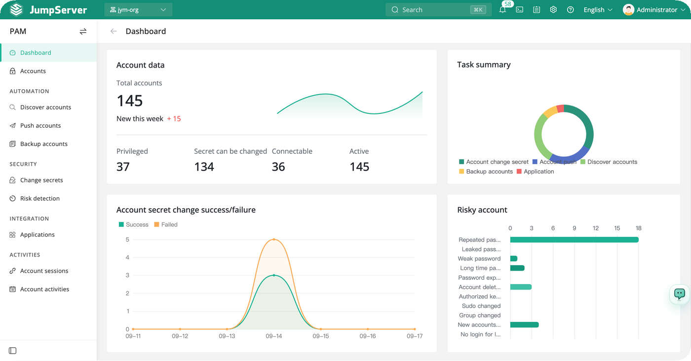
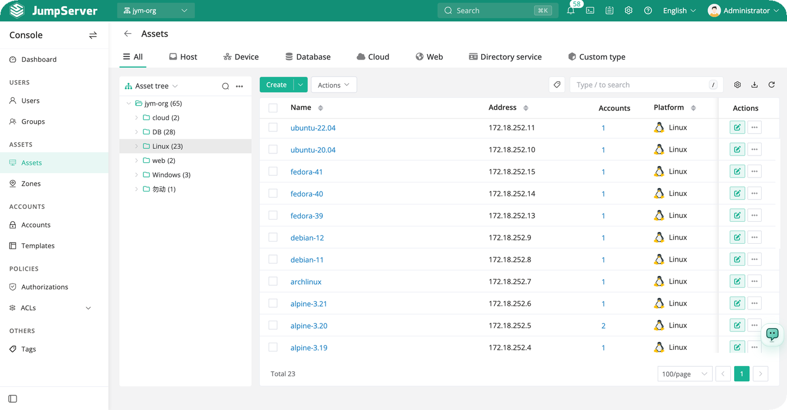
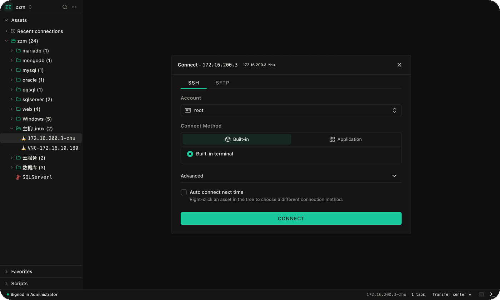
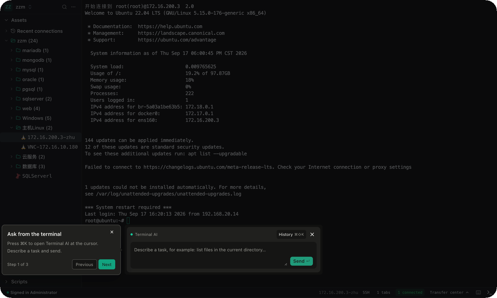
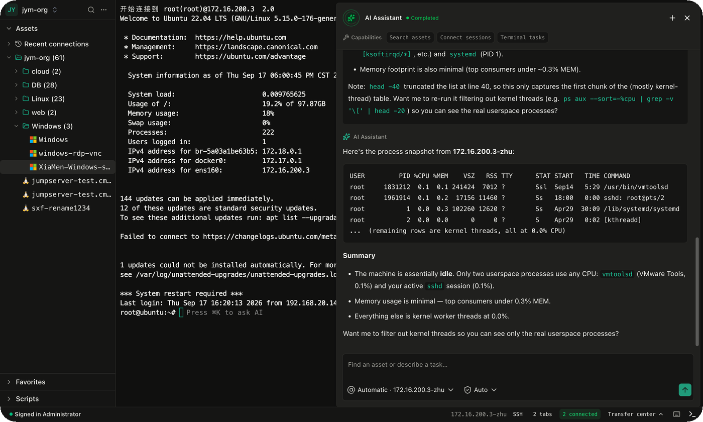
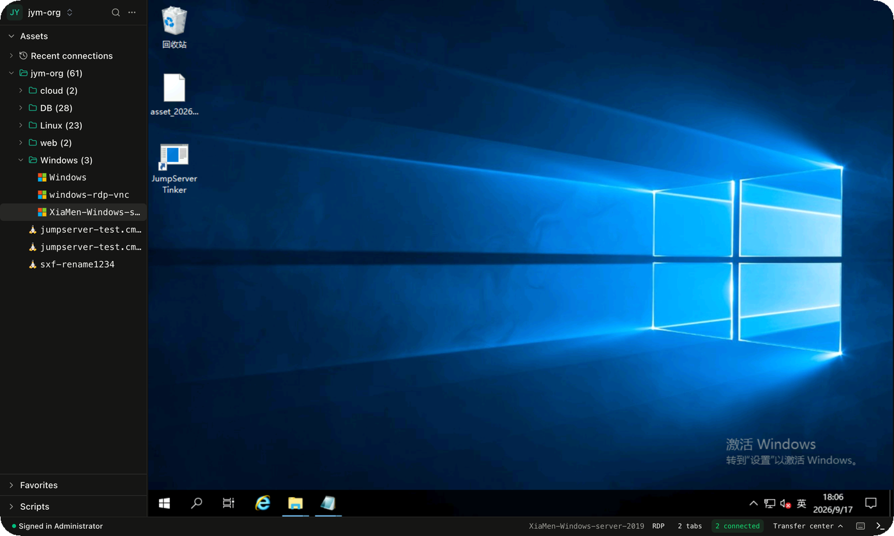
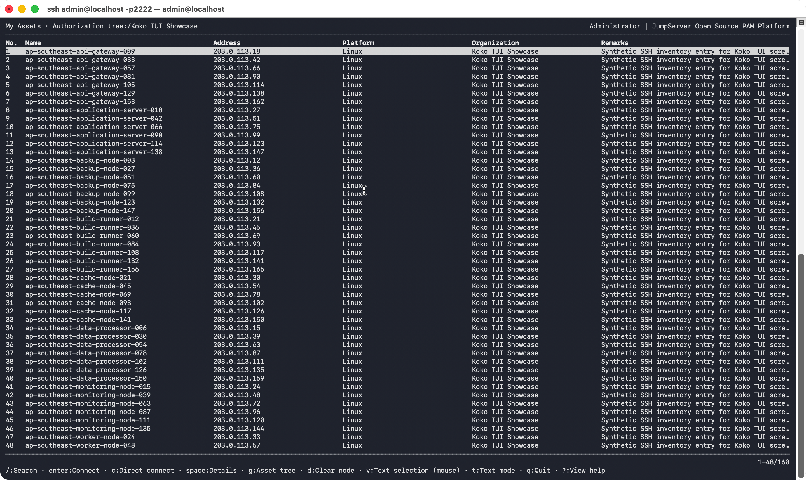
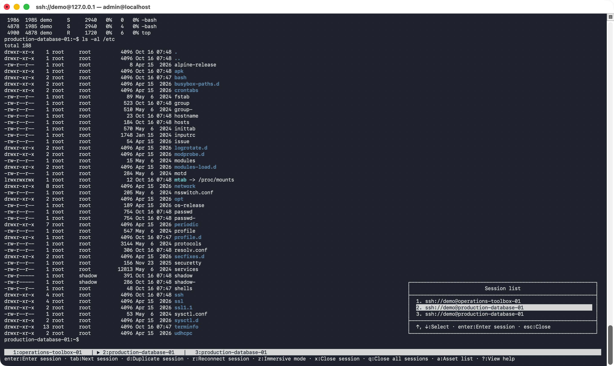
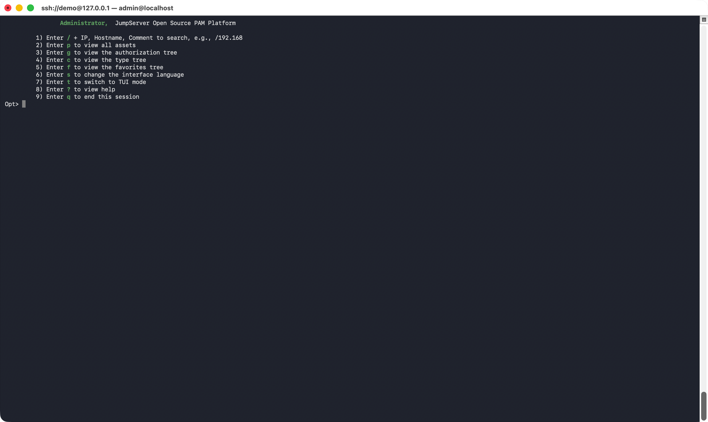
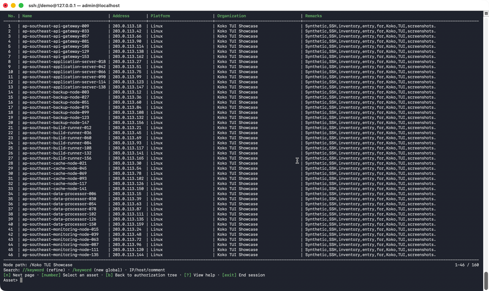

<div align="center">
  <a name="readme-top"></a>
  <a href="https://fortserver.com" target="_blank"></a>

## Une plateforme PAM open source (bastion)

[![][license-shield]][license-link]
[![][docs-shield]][docs-link]
[![][deepwiki-shield]][deepwiki-link]
[![][discord-shield]][discord-link]
[![][docker-shield]][docker-link]
[![][github-release-shield]][github-release-link]
[![][github-stars-shield]][github-stars-link]

[English](/README.md) · [中文(简体)](/readmes/README.zh-hans.md) · [中文(繁體)](/readmes/README.zh-hant.md) · [日本語](/readmes/README.ja.md) · [Português (Brasil)](/readmes/README.pt-br.md) · [Español](/readmes/README.es.md) · [Français](/readmes/README.fr.md) · [Русский](/readmes/README.ru.md) · [한국어](/readmes/README.ko.md) · [Tiếng Việt](/readmes/README.vi.md)

</div>

<br/>

## Qu’est-ce que fortserver ?

fortserver est une plateforme open source de gestion des accès à privilèges (PAM) dotée de fonctionnalités d’intelligence artificielle. Elle offre aux équipes DevOps et informatiques un espace de travail unifié pour accéder en toute sécurité à SSH, RDP, Kubernetes, des bases de données, des sites web, RemoteApp, VirtualApp et bien plus encore.


## Démarrage rapide

Préparez un serveur Linux 64 bits vierge disposant d’au moins 4 cœurs de processeur et 8 Go de RAM.

```sh
curl -sSL https://github.com/fortserver/fortserver/releases/latest/download/quick_start.sh | bash
```

Ouvrez fortserver dans votre navigateur à l’adresse `http://your-fortserver-ip/`

- Nom d’utilisateur : `admin`
- Mot de passe : `ChangeMe`

## Captures d’écran

<p align="center">
  
  
</p>

<p align="center">
  
  
</p>

<p align="center">
  
  
</p>

<p align="center">
  
  
</p>

<p align="center">
  
  
</p>

## Composants

fortserver regroupe ses composants selon leur rôle. Les projets principaux fournissent la plateforme, l’interface web, le terminal, les connexions aux protocoles et les fonctionnalités d’IA. Les composants Enterprise étendent l’accès aux applications et aux protocoles. Les services complémentaires gèrent les enregistrements de session et l’exploitation des hôtes, tandis que les outils de déploiement simplifient l’installation et la mise à disposition sur le web.

### Projets principaux

<table width="100%">
  <thead>
    <tr>
      <th width="160" align="left">Projet</th>
      <th width="135" align="center"><div align="center">Version</div></th>
      <th width="550" align="center"><div align="center">Description</div></th>
    </tr>
  </thead>
  <tbody>
    <tr>
      <td width="160" align="left" nowrap><a href="https://github.com/fortserver/fortserver">fortserver</a></td>
      <td width="135" align="center"><div align="center"><a href="https://github.com/fortserver/fortserver/tags"></a></div></td>
      <td width="550" align="left">Plateforme open source de gestion des accès à privilèges</td>
    </tr>
    <tr>
      <td width="160" align="left" nowrap><a href="https://github.com/fortserver/lina">Lina</a></td>
      <td width="135" align="center"><div align="center"><a href="https://github.com/fortserver/lina/tags"></a></div></td>
      <td width="550" align="left">Interface web de fortserver</td>
    </tr>
    <tr>
      <td width="160" align="left" nowrap><a href="https://github.com/fortserver/luna">Luna</a></td>
      <td width="135" align="center"><div align="center"><a href="https://github.com/fortserver/luna/tags"></a></div></td>
      <td width="550" align="left">Terminal web et client natif de fortserver</td>
    </tr>
    <tr>
      <td width="160" align="left" nowrap><a href="https://github.com/fortserver/koko">KoKo</a></td>
      <td width="135" align="center"><div align="center"><a href="https://github.com/fortserver/koko/tags"></a></div></td>
      <td width="550" align="left">Connecteur et proxy polyvalents pour les protocoles de fortserver</td>
    </tr>
    <tr>
      <td width="160" align="left" nowrap><a href="https://github.com/fortserver/chen">Chen</a></td>
      <td width="135" align="center"><div align="center"><a href="https://github.com/fortserver/chen/tags"></a></div></td>
      <td width="550" align="left">Connecteur web aux bases de données de fortserver</td>
    </tr>
    <tr>
      <td width="160" align="left" nowrap><a href="https://github.com/fortserver/kael">Kael</a></td>
      <td width="135" align="center"><div align="center"><a href="https://github.com/fortserver/kael/tags"></a></div></td>
      <td width="550" align="left">Composant IA de fortserver</td>
    </tr>
  </tbody>
</table>

### Composants Enterprise

<table width="100%">
  <thead>
    <tr>
      <th width="160" align="left">Projet</th>
      <th width="135" align="center"><div align="center">Version</div></th>
      <th width="550" align="center"><div align="center">Description</div></th>
    </tr>
  </thead>
  <tbody>
    <tr>
      <td width="160" align="left" nowrap><a href="https://github.com/fortserver/tinker">Tinker</a></td>
      <td width="135" align="center"><div align="center"></div></td>
      <td width="550" align="left">Connecteur d’applications Windows de fortserver (gratuit pour l’édition Community)</td>
    </tr>
    <tr>
      <td width="160" align="left" nowrap><a href="https://github.com/fortserver/Panda">Panda</a></td>
      <td width="135" align="center"><div align="center"></div></td>
      <td width="550" align="left">Connecteur d’applications Linux de fortserver Enterprise Edition</td>
    </tr>
    <tr>
      <td width="160" align="left" nowrap><a href="https://github.com/fortserver/razor">Razor</a></td>
      <td width="135" align="center"><div align="center"></div></td>
      <td width="550" align="left">Proxy du protocole RDP de fortserver Enterprise Edition</td>
    </tr>
    <tr>
      <td width="160" align="left" nowrap><a href="https://github.com/fortserver/magnus">Magnus</a></td>
      <td width="135" align="center"><div align="center"></div></td>
      <td width="550" align="left">Proxy des protocoles de bases de données de fortserver Enterprise Edition</td>
    </tr>
    <tr>
      <td width="160" align="left" nowrap><a href="https://github.com/fortserver/nec">Nec</a></td>
      <td width="135" align="center"><div align="center"></div></td>
      <td width="550" align="left">Proxy du protocole VNC de fortserver Enterprise Edition</td>
    </tr>
  </tbody>
</table>

### Services complémentaires

<table width="100%">
  <thead>
    <tr>
      <th width="160" align="left">Projet</th>
      <th width="135" align="center"><div align="center">Version</div></th>
      <th width="550" align="center"><div align="center">Description</div></th>
    </tr>
  </thead>
  <tbody>
    <tr>
      <td width="160" align="left" nowrap><a href="https://github.com/fortserver/video-worker">Video&nbsp;Worker</a></td>
      <td width="135" align="center"><div align="center"></div></td>
      <td width="550" align="left">Service de transcodage des enregistrements de session de fortserver Enterprise Edition</td>
    </tr>
    <tr>
      <td width="160" align="left" nowrap><a href="https://github.com/fortserver/jdmc">JDMC</a></td>
      <td width="135" align="center"><div align="center"></div></td>
      <td width="550" align="left">Service d’exploitation et de gestion des hôtes de fortserver Enterprise Edition</td>
    </tr>
  </tbody>
</table>

### Déploiement et outils

<table width="100%">
  <thead>
    <tr>
      <th width="160" align="left">Projet</th>
      <th width="135" align="center"><div align="center">Version</div></th>
      <th width="550" align="center"><div align="center">Description</div></th>
    </tr>
  </thead>
  <tbody>
    <tr>
      <td width="160" align="left" nowrap><a href="https://github.com/fortserver/installer">Installer</a></td>
      <td width="135" align="center"><div align="center"><a href="https://github.com/fortserver/installer/tags"></a></div></td>
      <td width="550" align="left">Outil d’installation et d’administration de fortserver</td>
    </tr>
    <tr>
      <td width="160" align="left" nowrap><a href="https://github.com/fortserver/docker-web">Docker&nbsp;Web</a></td>
      <td width="135" align="center"><div align="center"><a href="https://github.com/fortserver/docker-web/tags"></a></div></td>
      <td width="550" align="left">Passerelle web et ressources statiques de fortserver</td>
    </tr>
  </tbody>
</table>

## Contribution

Les contributions sont les bienvenues. Consultez [CONTRIBUTING.md][contributing-link] pour connaître les directives.

## Licence

Copyright (c) 2014-2026 fortserver. Tous droits réservés.

Ce projet est distribué sous la licence GNU General Public License version 3 (GPLv3, la « Licence »). Vous ne pouvez utiliser ce fichier que conformément à la Licence. Vous pouvez en obtenir une copie à l’adresse suivante :

https://www.gnu.org/licenses/gpl-3.0.html

Sauf disposition contraire de la législation applicable ou accord écrit, le logiciel distribué sous la Licence est fourni « EN L’ÉTAT », SANS GARANTIE NI CONDITION D’AUCUNE SORTE, expresse ou implicite. Consultez la Licence pour connaître les autorisations et limitations spécifiques.

<!-- fortserver official link -->
[docs-link]: https://fortserver.com/docs
[discord-link]: https://discord.com/invite/W6vYXmAQG2
[deepwiki-link]: https://deepwiki.com/fortserver/fortserver/
[contributing-link]: https://github.com/fortserver/fortserver/blob/dev/CONTRIBUTING.md

<!-- fortserver Other link-->
[license-link]: https://www.gnu.org/licenses/gpl-3.0.html
[docker-link]: https://hub.docker.com/u/fortserver
[github-release-link]: https://github.com/fortserver/fortserver/releases/latest
[github-stars-link]: https://github.com/fortserver/fortserver
[github-issues-link]: https://github.com/fortserver/fortserver/issues

<!-- Shield link-->
[docs-shield]: https://img.shields.io/badge/documentation-148F76
[github-release-shield]: https://img.shields.io/github/v/release/fortserver/fortserver
[github-stars-shield]: https://img.shields.io/github/stars/fortserver/fortserver?color=%231890FF&style=flat-square   
[docker-shield]: https://img.shields.io/docker/pulls/fortserver/jms_all.svg
[license-shield]: https://img.shields.io/github/license/fortserver/fortserver
[deepwiki-shield]: https://img.shields.io/badge/deepwiki-devin?color=blue
[discord-shield]: https://img.shields.io/discord/1194233267294052363?style=flat&logo=discord&logoColor=%23f5f5f5&labelColor=%235462eb&color=%235462eb
